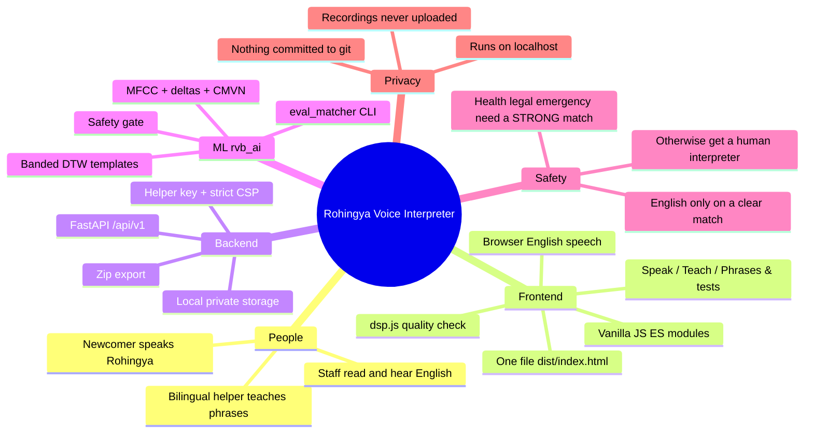
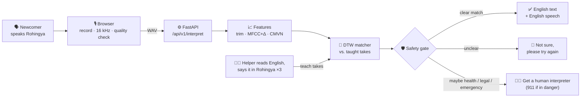

<div align="center">

# 🎙️ Rohingya Voice Interpreter

**Speak Rohingya → get English text and English speech.**

A voice-only bridge for Rohingya newcomers in Canada. Built by **WATai** with the **Welcome Centre**.

[](https://github.com/msamin-25/Rohingya-Watai-proj/actions/workflows/ci.yml)


</div>

---

## Why

Rohingya has **no common writing system**. Text-based translation tools don't work for most
speakers, so this app never asks anyone to read or write Rohingya. It goes **voice → English only**.

The MVP **learns phrases that people teach it by voice** (MFCC features + DTW template matching).
It is **not a general translator yet**, and it is built to say *"Not sure"* rather than guess.

## Project mindmap



## How it works



More detail (component diagram, sequence diagram, safety-gate flowchart, API, export format):
**[docs/ARCHITECTURE.md](docs/ARCHITECTURE.md)**.

## The safety rules

1. **"Not sure" is always better than a wrong answer.**
2. **Health, legal and emergency** phrases are shown only on a **strong** match: very close,
   clearly ahead of every other phrase, and confirmed by at least two taught takes.
3. If a sensitive phrase is a close competitor, the app shows **no English** and asks for a
   **human interpreter** (for emergencies: *"If someone is in danger, call 911 now."*).
4. The code refuses thresholds where the sensitive gate is looser than the general one.

## Quick start

**Requirements:** Python 3.10+ and Node 20+ (tested with Python 3.13 and Node 22 on macOS).

### macOS / Linux

```bash
make setup     # venv, Python + npm packages, frontend build, .env with a fresh helper key
make test      # ml + backend + frontend test suites
make run       # http://localhost:8000
```

### Windows (PowerShell, no `make` needed)

```powershell
py -3 -m venv .venv
.venv\Scripts\python -m pip install -e "ml[dev,llm]" -r backend\requirements-dev.txt
cd frontend; npm ci; npm run build; cd ..
.venv\Scripts\python scripts\make_env.py
cd ml; ..\.venv\Scripts\python -m pytest -q; cd ..
cd backend; ..\.venv\Scripts\python -m pytest -q
..\.venv\Scripts\python -m uvicorn app.main:factory --factory --reload --port 8000
```

Then open **http://localhost:8000**. Use `localhost`, not an IP address, or the browser will block the microphone.
On **Teach**, paste `RVB_ADMIN_TOKEN` from `.env` to unlock helper features.

### VS Code

Open the folder and accept the recommended extensions. `.venv` is selected automatically.

| What | How |
|---|---|
| Run the server with the debugger | Run and Debug → **Backend: uvicorn** |
| Build the frontend | Terminal → Run Task → **build frontend** |
| Run every test suite | Terminal → Run Task → **test all** |
| Run the server with auto-reload | Terminal → Run Task → **run backend** |

## Using the app

| Tab | Who | What |
|---|---|---|
| 🎙️ **Speak** | Newcomer | Tap, speak Rohingya, tap again. See and hear the English, or "Not sure". |
| 🧑‍🏫 **Teach** | Bilingual helper | Read the English phrase, say it in Rohingya. 3 takes per phrase. |
| 🧪 **Phrases & tests** | Helper | Record test takes (incl. phrases never taught), play or delete recordings, download a .zip, add English phrases. |

Measure accuracy on real voices with **[docs/TESTING_WITH_YOUR_VOICE.md](docs/TESTING_WITH_YOUR_VOICE.md)**:

```bash
python -m rvb_ai.eval_matcher ~/rvb-eval/recordings
```

It reports top-1 accuracy, the wrong-and-shown rate, confusions and evidence-based threshold
suggestions. It **never** changes the app's thresholds by itself.

## Repository layout

```
├── frontend/              vanilla JS → esbuild → ONE file: frontend/dist/index.html (committed)
│   ├── src/js/            main · api · recorder · dsp (port of features.py) · wav · messages
│   └── tests/             node --test
├── backend/               FastAPI app (API under /api/v1), imports rvb_ai
│   ├── app/               main · api · engine · storage · security · settings
│   └── tests/             pytest, incl. security tests
├── ml/                    the rvb_ai package
│   ├── rvb_ai/            audio · features · matcher · safety · phrases · recordings · eval_matcher
│   └── tests/             pytest, incl. test_parity.py (dsp.js ≡ features.py)
├── data/phrases.seed.json single source of truth for starter phrases (English only)
├── e2e/                   Playwright browser tests (fake microphone)
├── docs/                  ARCHITECTURE.md · TESTING_WITH_YOUR_VOICE.md
├── scripts/make_env.py    creates .env with a fresh random helper key
└── .vscode/               launch + tasks + settings
```

## Tests

| Suite | Command | Covers |
|---|---|---|
| ML | `cd ml && python -m pytest -q` | WAV I/O, trimming, MFCC, DTW vs. reference, matcher, **safety gate**, eval CLI, **JS↔Python parity** |
| Backend | `cd backend && python -m pytest -q` | API flows, export format, **helper key, host check, CSP, upload limits, path traversal, file permissions** |
| Frontend | `cd frontend && npm test` | FFT, features, quality checks, WAV encoder, **only a match shows English** |
| Browser | `make e2e` | real Chromium with a fake microphone; no CSP or script errors |

CI also checks that `frontend/dist` is up to date, that no `.env` / audio / `.zip` is tracked, and
runs `pip-audit` + `npm audit`.

## Contributing rules

- **Never invent Rohingya words, spellings or translations.** Only English goes in code and data.
- **Never weaken the safety gate.**
- `frontend/src/js/dsp.js` is a port of `ml/rvb_ai/features.py`. Change both, then run `ml/tests/test_parity.py`.
- After changing `frontend/src`, run `npm run build` and commit `frontend/dist`.
- **Never commit** `.env`, `var/`, `*.wav`, `*.m4a` or `*.zip`. Recordings are private voice data.

## Security & privacy

Runs on `127.0.0.1` only; recordings stay on the computer, outside the repo. See **[SECURITY.md](SECURITY.md)**.

## Roadmap

- [ ] Calibrate thresholds on real Rohingya recordings from several speakers
- [ ] Teach more phrases with the Welcome Centre, chosen by staff and community members
- [ ] Speaker-robust features (e.g. self-supervised speech embeddings) for better new-voice accuracy
- [ ] Offline / kiosk mode
- [ ] Consent flow and data-retention policy before any pilot with newcomers

## Acknowledgements

Built by **WATai** in partnership with the **Welcome Centre**, for and with the Rohingya community.
