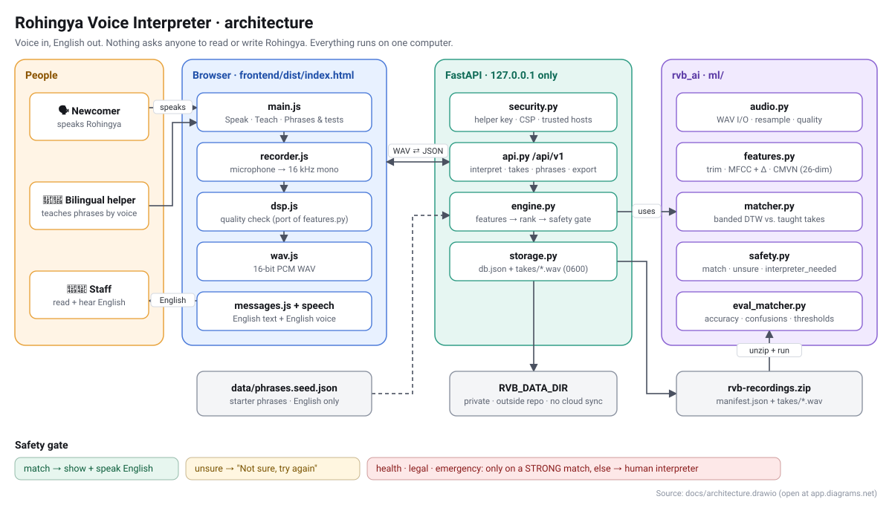
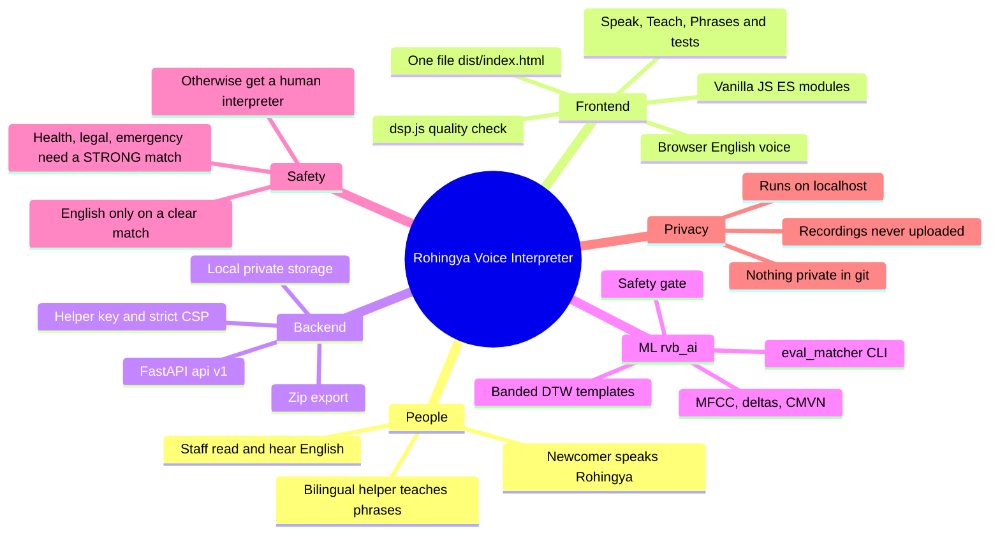
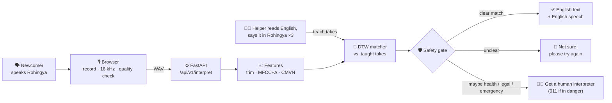
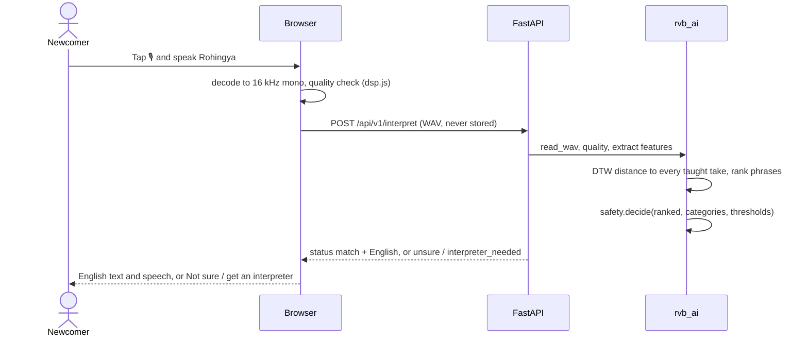
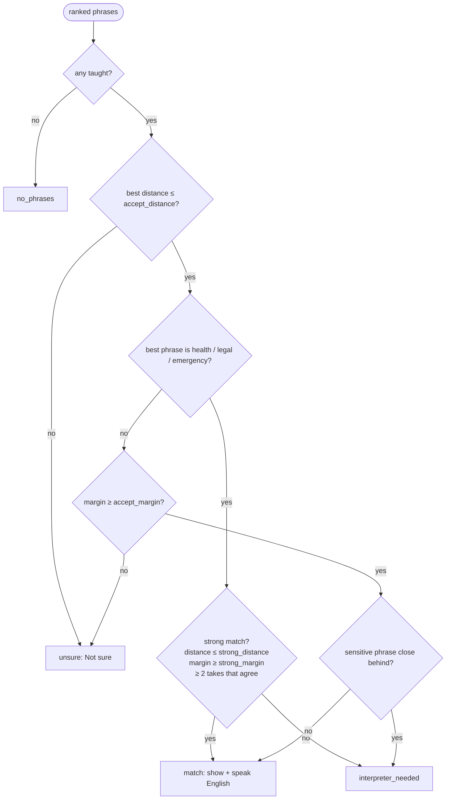

<div align="center">

# 🎙️ Rohingya Voice Interpreter

**Speak Rohingya → get English text and English speech.**

A voice-only bridge for Rohingya newcomers in Canada, built by **WATai** with the **Welcome Centre**.


</div>

---

## Contents

1. [Why](#why)
2. [Architecture at a glance (draw.io)](#architecture-at-a-glance)
3. [Project mindmap](#project-mindmap)
4. [How it works](#how-it-works)
5. [The safety gate](#the-safety-gate)
6. [Inside the ML: features and matcher](#inside-the-ml)
7. [API and export format](#api-and-export-format)
8. [Quick start](#quick-start)
9. [Using the app](#using-the-app)
10. [Tests and checks](#tests-and-checks)
11. [Privacy and security](#privacy-and-security)
12. [Repository layout](#repository-layout)
13. [Contributing rules](#contributing-rules)
14. [Roadmap](#roadmap)

---

## Why

Rohingya has **no common writing system**. Text-based translation tools don't work for most
speakers, so this app never asks anyone to read or write Rohingya. It goes **voice → English only**.

The MVP **learns phrases that people teach it by voice** (MFCC features + DTW template matching).
It is **not a general translator yet**, and it is designed to say *"Not sure"* rather than guess.

## Architecture at a glance



> The diagram is a **draw.io** file: [`docs/architecture.drawio`](docs/architecture.drawio).
> Open it at [app.diagrams.net](https://app.diagrams.net) (*File → Open from → Device*)
> or in VS Code with the *Draw.io Integration* extension. `docs/architecture.svg` is the
> same diagram as an image.

| Layer | Where | Job |
|---|---|---|
| **People** | | Newcomer speaks Rohingya; a bilingual helper teaches phrases; staff read and hear English |
| **Browser** | `frontend/` → one file `frontend/dist/index.html` | Records the microphone, checks quality, sends WAV, shows and speaks the result |
| **Backend** | `backend/app/` (FastAPI on `127.0.0.1`) | `/api/v1` endpoints, helper key, security headers, private storage |
| **ML core** | `ml/rvb_ai/` | Features, DTW matcher, safety gate, evaluation CLI |
| **Data** | `data/phrases.seed.json`, `RVB_DATA_DIR` | English starter phrases; private recordings outside the repo |

## Project mindmap



## How it works

### The big picture



### Step by step

1. **Teach.** A bilingual helper opens the **Teach** tab, reads an English phrase
   (e.g. *"I need a doctor."*) and says it in Rohingya, 3 times. Each recording is a *template*.
   Nothing is ever written in Rohingya.
2. **Speak.** A newcomer taps the microphone and speaks.
3. **Record.** The browser records, decodes to 16 kHz mono, and `dsp.js` checks the recording
   is not too short, quiet or loud, so the person can retry straight away.
4. **Match.** The server turns the audio into MFCC features and compares it with every template
   using dynamic time warping (DTW). This tolerates speaking faster or slower.
5. **Decide.** The safety gate decides whether the closest phrase is clear enough to show.
6. **Answer.** The browser shows the English and speaks it with the computer's own English voice.
   Otherwise it says *"Not sure"* or *"Please get a human interpreter."*

### One request in detail



## The safety gate

1. **"Not sure" is always better than a wrong answer.**
2. **Health, legal and emergency** phrases are shown only on a **strong** match: very close,
   clearly ahead of every other phrase, and confirmed by at least two taught takes that agree.
3. If a sensitive phrase is a close competitor of a general match, **no English** is shown and
   the app asks for a **human interpreter** (for emergencies: *"If someone is in danger, call 911 now."*).
4. The code refuses any thresholds where the sensitive gate is looser than the general one.



| Threshold | Default | Meaning |
|---|---|---|
| `accept_distance` | 2.6 | Farther than this from every taught take → "Not sure" |
| `accept_margin` | 0.08 | Best phrase must beat the next one by at least 8 % |
| `strong_distance` | 2.2 | Sensitive phrases must be at least this close |
| `strong_margin` | 0.15 | …and beat the next phrase by at least 15 % |

Defaults were sanity-checked on synthesized English speech (0 wrong answers shown, for the same
voice and a new voice). **Calibrate them on real Rohingya recordings** with
`python -m rvb_ai.eval_matcher`; it suggests values with evidence and never changes them by itself.

## Inside the ML

### Feature pipeline: `ml/rvb_ai/features.py` ≡ `frontend/src/js/dsp.js`

| Step | Setting |
|---|---|
| Resample | linear interpolation to 16 kHz (the browser already decodes at 16 kHz) |
| Trim silence | 25 ms frames; keep frames louder than max(loudest − 35 dB, −60 dBFS), ±5 frames padding |
| Pre-emphasis | 0.97 |
| Frames | 400 samples (25 ms), hop 160 (10 ms), Hamming window, 512-point FFT |
| Mel | 26 triangular filters, 20–8000 Hz, HTK mel scale, log energy |
| Cepstrum | 13 MFCC (orthonormal DCT-II) + 13 deltas = 26 dimensions |
| Normalisation | per-utterance mean and variance (CMVN) |

`ml/tests/test_parity.py` runs `dsp.js` in Node and checks every step matches Python to 1e-6.

### Matcher: `ml/rvb_ai/matcher.py`

* **Templates.** Every *teach* take is a template. There is no separate training step; the app
  learns from each new take immediately.
* **Distance.** DTW with a 30 % Sakoe-Chiba band and Euclidean frame cost, normalised by the
  two lengths. Recordings more than 2.5× different in length never match. Each row is computed
  with a vectorised min-plus scan, so comparing against ~50 templates takes well under a second.
* **Ranking.** For each phrase, the closest and second-closest template distances.

## API and export format

All endpoints are under `/api/v1`. ✓ = needs the helper key in the `X-RVB-Key` header.

| Method | Path | Key | Purpose |
|---|---|---|---|
| GET | `/health` | | liveness |
| GET | `/phrases` | | phrases + take counts |
| POST | `/interpret` | | WAV → result (audio is **not** stored) |
| GET | `/auth/check` | ✓ | verify the helper key |
| POST | `/phrases` | ✓ | add an English phrase (`english`, `category`) |
| DELETE | `/phrases/{id}` | ✓ | delete a custom phrase and its takes |
| GET / POST | `/takes` | ✓ | list / add a take (`audio`, `kind` = teach or test, `speaker`, `phrase_id`, `note`) |
| GET | `/takes/{id}/audio` | ✓ | play a take |
| DELETE | `/takes/{id}` · `/takes?speaker=&kind=` | ✓ | delete one / many |
| GET | `/export` | ✓ | `rvb-recordings.zip` for the evaluation CLI |

Export format `rvb-recordings/1`:

```
recordings/
  manifest.json   {"format", "exported_at", "phrases": [{id, english, category, ...}],
                   "takes": [{id, phrase_id | null, kind, speaker, note, created_at, file}]}
  takes/<id>.wav  16 kHz mono PCM16
```

`phrase_id: null` marks a phrase that was never taught; the right answer for it is "Not sure".

## Quick start

**Requirements:** Python 3.10+ and Node 20+ (tested with Python 3.13 and Node 22 on macOS).

### macOS / Linux

```bash
make setup     # venv, Python + npm packages, frontend build, .env with a fresh helper key
make test      # ml + backend + frontend test suites
make run       # http://localhost:8000
```

### Windows (PowerShell, no `make` needed)

```powershell
py -3 -m venv .venv
.venv\Scripts\python -m pip install -e "ml[dev,llm]" -r backend\requirements-dev.txt
cd frontend; npm ci; npm run build; cd ..
.venv\Scripts\python scripts\make_env.py
cd ml; ..\.venv\Scripts\python -m pytest -q; cd ..
cd backend; ..\.venv\Scripts\python -m pytest -q
..\.venv\Scripts\python -m uvicorn app.main:factory --factory --reload --port 8000
```

Open **http://localhost:8000**. Use `localhost`, not an IP address, or the browser will block the
microphone. If port 8000 is busy, use `--port 8001`. To unlock helper features, paste
`RVB_ADMIN_TOKEN` from `.env` on the **Teach** tab.

### VS Code

Open the folder and accept the recommended extensions; `.venv` is selected automatically.

| What | How |
|---|---|
| Run the server with the debugger | Run and Debug → **Backend: uvicorn** |
| Build the frontend | Terminal → Run Task → **build frontend** |
| Run every test suite | Terminal → Run Task → **test all** |
| Run the server with auto-reload | Terminal → Run Task → **run backend** |

## Using the app

| Tab | Who | What |
|---|---|---|
| 🎙️ **Speak** | Newcomer | Tap, speak Rohingya, tap again. See and hear the English, or "Not sure". |
| 🧑‍🏫 **Teach** | Bilingual helper | Read the English phrase, say it in Rohingya. 3 takes per phrase. |
| 🧪 **Phrases & tests** | Helper | Record test takes (including phrases never taught), play or delete recordings, download a .zip, add English phrases. |

To measure accuracy on real voices, follow **[docs/TESTING_WITH_YOUR_VOICE.md](docs/TESTING_WITH_YOUR_VOICE.md)**, then run:

```bash
python -m rvb_ai.eval_matcher ~/rvb-eval/recordings
```

It reports top-1 accuracy, the wrong-and-shown rate, which phrases get confused, and threshold
suggestions with the evidence behind them.

## Tests and checks

| Suite | Command | Covers |
|---|---|---|
| ML | `cd ml && python -m pytest -q` | WAV I/O, trimming, MFCC, DTW vs. a reference, matcher, **safety gate**, eval CLI, **JS ↔ Python parity** |
| Backend | `cd backend && python -m pytest -q` | API flows, export format, **helper key, host check, CSP, upload limits, path traversal, file permissions** |
| Frontend | `cd frontend && npm test` | FFT, features, quality checks, WAV encoder, **only a match shows English** |
| Browser | `make e2e` | real Chromium with a fake microphone; no CSP or script errors |
| **Everything** | `make check` | rebuilds and verifies `frontend/dist`, all tests, no private data in git, `pip-audit` + `npm audit` |

Run `make check` before every commit or push.

## Privacy and security

* Runs on **`127.0.0.1` only** and answers only to `localhost` (blocks DNS rebinding).
* Teaching, deleting and exporting need the **helper key**; no cross-site requests are allowed (blocks CSRF).
* Strict **Content-Security-Policy** with hashed inline code, and all text is inserted safely (blocks XSS).
* Upload size limit, WAV-only decoding, validated ids (no path traversal).
* **Recordings stay on the computer** in `RVB_DATA_DIR`, outside the repo and outside cloud-synced
  folders (on macOS: `~/Library/Application Support/RohingyaVoiceInterpreter`), with owner-only
  permissions. Audio sent to **Speak** is never stored.
* `.env`, `var/`, `*.wav`, `*.m4a` and `*.zip` are git-ignored and checked by `make check`.
* Exact npm versions, `ignore-scripts=true`, dependency audits.

Details: **[SECURITY.md](SECURITY.md)**.

## Repository layout

```
├── frontend/              vanilla JS → esbuild → ONE file: frontend/dist/index.html (committed)
│   ├── src/js/            main · api · recorder · dsp (port of features.py) · wav · messages
│   └── tests/             node --test
├── backend/               FastAPI app (API under /api/v1), imports rvb_ai
│   ├── app/               main · api · engine · storage · security · settings
│   └── tests/             pytest, incl. security tests
├── ml/                    the rvb_ai package
│   ├── rvb_ai/            audio · features · matcher · safety · phrases · recordings · eval_matcher
│   └── tests/             pytest, incl. test_parity.py (dsp.js ≡ features.py)
├── data/phrases.seed.json single source of truth for starter phrases (English only)
├── e2e/                   Playwright browser tests (fake microphone)
├── docs/                  architecture.drawio + .svg · TESTING_WITH_YOUR_VOICE.md
├── scripts/make_env.py    creates .env with a fresh random helper key
├── .vscode/               launch + tasks + settings
└── Makefile               setup · test · run · eval · e2e · check
```

## Contributing rules

- **Never invent Rohingya words, spellings or translations.** Only English goes in code and data.
- **Never weaken the safety gate.**
- `frontend/src/js/dsp.js` is a port of `ml/rvb_ai/features.py`. Change both the same way, then run `ml/tests/test_parity.py`.
- After changing `frontend/src`, run `npm run build` and commit `frontend/dist`.
- **Never commit** `.env`, `var/`, `*.wav`, `*.m4a` or `*.zip`. Recordings are private voice data.
- Run `make check` before every commit.

## Roadmap

- [ ] Calibrate thresholds on real Rohingya recordings from several speakers
- [ ] Teach more phrases chosen with Welcome Centre staff and community members
- [ ] More speaker-robust features for better accuracy with new voices
- [ ] Offline / kiosk mode
- [ ] Consent flow and data-retention policy before any pilot with newcomers


