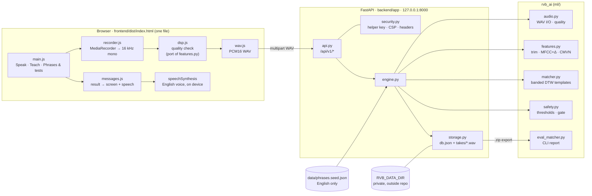
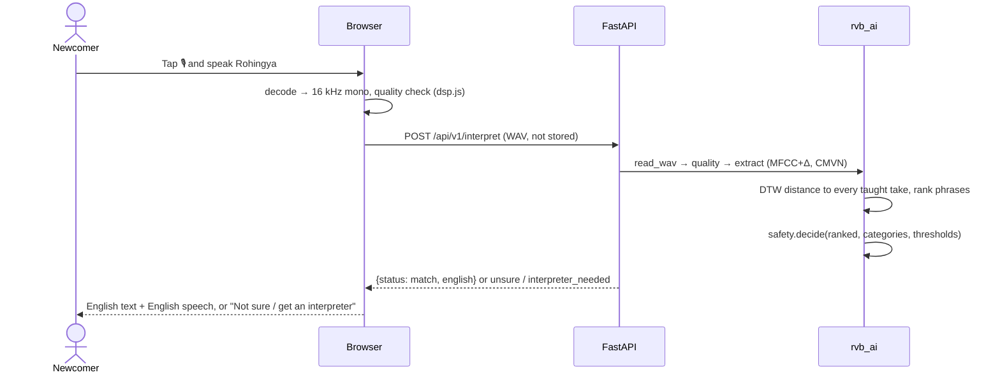
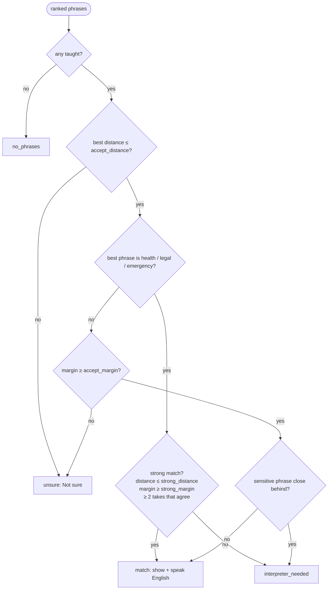

# Architecture

Voice in, English out. Rohingya has no common writing system, so **nothing in the app asks anyone
to read or write Rohingya**. Phrases are taught by voice; their meaning is stored in English only.

## Components



## Interpreting a phrase



## Feature pipeline (`features.py` = `dsp.js`)

| Step | Setting |
|---|---|
| Resample | linear interpolation to 16 kHz (the browser already decodes at 16 kHz) |
| Trim silence | 25 ms frames; keep frames louder than max(loudest − 35 dB, −60 dBFS), ±5 frames padding |
| Pre-emphasis | 0.97 |
| Frames | 400 samples (25 ms), hop 160 (10 ms), Hamming window, 512-point FFT |
| Mel | 26 triangular filters, 20–8000 Hz, HTK mel scale, log energy |
| Cepstrum | 13 MFCC (orthonormal DCT-II) + 13 deltas = 26 dims |
| Normalisation | per-utterance mean and variance (CMVN) |

`ml/tests/test_parity.py` runs `dsp.js` in Node and checks every step matches Python to 1e-6.

## Matcher

* **Templates**: each *teach* take is one template (no training step; the app learns on every take).
* **Distance**: DTW with a Sakoe-Chiba band (30 %), Euclidean frame cost, normalised by `n + m`.
  Recordings whose lengths differ by more than 2.5× are never matched. Rows are computed with a
  vectorised min-plus scan, so matching ~50 templates takes well under a second.
* **Ranking**: per phrase, the closest and second-closest template distances.

## Safety gate (`safety.py`)



`Thresholds` refuses any setting where the strong (sensitive) gate is looser than the general
one. Defaults: `accept_distance 2.6`, `accept_margin 0.08`, `strong_distance 2.2`, `strong_margin 0.15`.
They were sanity-checked on synthesized English speech; calibrate them on real Rohingya
recordings with `python -m rvb_ai.eval_matcher` (see [TESTING_WITH_YOUR_VOICE.md](TESTING_WITH_YOUR_VOICE.md)).

## API (`/api/v1`)

| Method | Path | Key | Purpose |
|---|---|---|---|
| GET | `/health` | | liveness |
| GET | `/phrases` | | phrases + take counts |
| POST | `/interpret` | | WAV → result (audio not stored) |
| GET | `/auth/check` | ✓ | verify helper key |
| POST | `/phrases` | ✓ | add an English phrase (`english`, `category`) |
| DELETE | `/phrases/{id}` | ✓ | delete a custom phrase and its takes |
| GET / POST | `/takes` | ✓ | list / add a take (`audio`, `kind` teach/test, `speaker`, `phrase_id`, `note`) |
| GET | `/takes/{id}/audio` | ✓ | play a take |
| DELETE | `/takes/{id}` · `/takes?speaker=&kind=` | ✓ | delete one / many |
| GET | `/export` | ✓ | `rvb-recordings.zip` for the eval CLI |

## Export format (`rvb-recordings/1`)

```
recordings/
  manifest.json   {"format", "exported_at", "phrases": [{id, english, category, ...}],
                   "takes": [{id, phrase_id|null, kind, speaker, note, created_at, file}]}
  takes/<id>.wav  16 kHz mono PCM16
```

`phrase_id: null` marks a phrase that was never taught (the right answer is "not sure").
